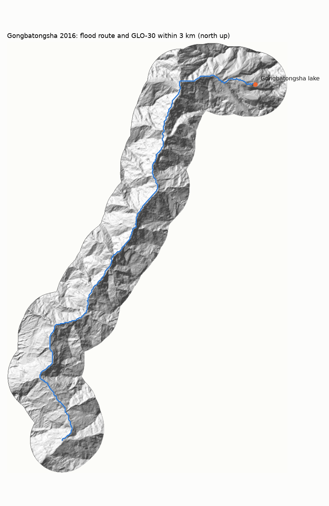
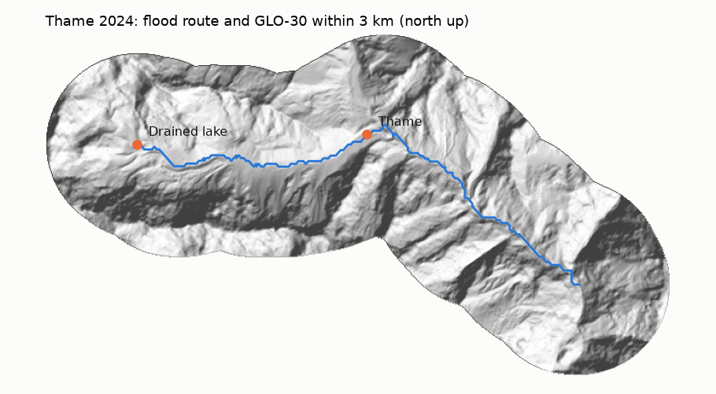
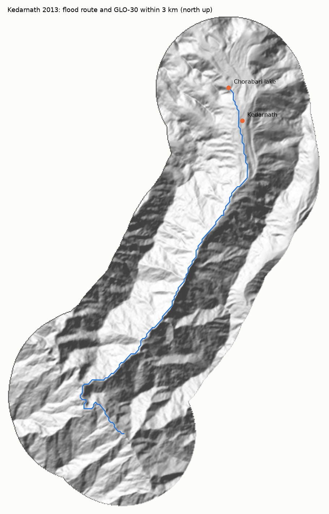

# P0 event data checks

One page per test event, checked on 26 Nov 2026. Each event has to have three things ready for
its hindcast: the terrain the flood ran down, the size of the water that started it, and the
evidence to score it against. South Lhonak 2023, the pilot, is covered by the lake-area and
terrain spikes.

How to rerun: `.venv\Scripts\python pipeline\scripts\p0_events.py --project master-bruin-515809-p2`.
It takes a few minutes on Earth Engine and ends with **13 of 13 checks passed**. Each event's full
numbers are in `event-<name>-checks.json`. Each check covers:

- **Route:** the flood route traced downhill on MERIT Hydro.
- **Terrain:** the Copernicus GLO-30 corridor around the route.
- **Lake:** its area in the autumns before and after, where satellites can see it.
- **Imagery:** clear Sentinel-2 and Landsat scenes within 120 days either side.
- **Rain:** GPM IMERG rain over the days before.

| Event | Route and terrain | Lake before → after | First clear image after | Satellite rain | Verdict |
|---|---|---|---|---|---|
| Gongbatongsha 2016 | 52 km to Barabise, 312 km² | Too small to measure; published 0.017 km², drained | Landsat, 17 Oct 2016 | 93 mm, 29 Jun–5 Jul | **Keep, but start the run at the confluence 6.5 km below the lake** |
| Thame 2024 | 20 km, passes 49 m from Thame at km 9.7, 132 km² | 0.044 → 0.015 km² (Sentinel-2) | Sentinel-2, 8 Sep 2024 | 88 mm, 9–16 Aug | Keep as planned |
| Kedarnath 2013 | 20 km, passes 144 m from Kedarnath at km 1.5, 134 km² | Documented 400 × 200 m, 262,000 m³ | Landsat, 22 Jun 2013 | 345 mm, 10–17 Jun | Keep; check the elevation model's date first |

All three corridors have complete elevation data. Each is under half the Teesta pilot's
742 km², so run time is not a concern.

---

## Gongbatongsha 2016 (Tibet into Nepal)

**What happened.** On the night of 5 July 2016, Gongbatongsha lake drained completely. It was a
1.7 × 10⁴ m² lake at 28°04′41″N 86°04′12″E, and it released about 1.1–1.2 × 10⁵ m³ of water.
A slope failure is the likely trigger (Cook 2018; Sattar 2022). The flood then turned into a
debris flow, picking up about 8.3 million m³ of sediment, about 70 times its water. Its peak grew
from about 620 m³/s at the lake to about 4,100 m³/s at the Zhangzangbo–Poiqu confluence, 6.5 km
downstream. It reached the confluence about 20 minutes after release and peaked there at about
47 minutes (Sattar 2022). It went on to destroy the Upper Bhote Koshi hydropower intake and
damage the Arniko highway, Kodari and Tatopani.

**The scoring evidence is strong, and it lies in Nepal.** Six broadband seismometers on the Bhote
Koshi recorded the flood (Cook 2018, Fig. 1C):

- The front passed four of them, about 21–29 km along the river, at about 15:15–15:40 UTC, moving
  at 8.7 m/s. A second pulse, of coarse sediment, followed at 5 m/s.
- Peak discharge at Chaku station was 1,500–2,100 m³/s.
- Peak discharges at more points down to Barabise are in the paper's Fig. 2 (table S4 of the
  supplement).

**What the check found.**

- **Route:** traced 51.9 km from the lake to about Barabise. It follows the Zhangzangbo valley
  west and then the Bhote Koshi south.
- **Lake location:** Landsat 8 images from autumn 2016 show a fresh debris track starting at the
  published coordinates, so the location is right.
- **Lake size:** it can't be measured by satellite.
  - Landsat's best water index at the lake is 0.17–0.21, below our 0.25 cut-off.
  - Sentinel-2 Level-1C counts snow as water: about 0.075 km² both before and after, for a lake
    of 0.017 km² that emptied.
  - So the published size is used, as with Chorabari.
- **Lake elevation:** GLO-30 reads 4,811 m at the lake point, not the 4,623 m in Sattar (2022).
  The difference is unexplained, and it doesn't matter if the run starts at the confluence.
- **Imagery:** clear Landsat on 17 Oct 2016 and Sentinel-2 on 30 Oct 2016, after the monsoon.
  Erosion and landslide scars from the flood stay visible for months, so the flooded-extent
  check works from these.

**What it means.** Moraine's solver moves water, not sediment, so it can't grow a
120,000 m³ water release into a 4,100 m³/s debris flow. Proposed change: **start the
Gongbatongsha run at the confluence, fed with Sattar's modelled flow there.** Then score it in
Nepal against the seismometer timing and the Chaku peak. That keeps a strong, independent timing
test while being honest about where the model starts. The station positions and exact arrival
times are in Cook's supplementary table S1 and the GFZ data repository, to collect in P3. The
other option is to drop it: the week-15 gate already allows keeping Kedarnath and one Nepal event.

## Thame 2024 (Khumbu, Nepal)

**What happened.** On 16 August 2024, Thyanbo lake, about 10 km above Thame, burst.

- **Trigger:** a rock or wet-snow avalanche fell into the upper of two lakes. Its wave overtopped
  that lake and breached the lower lake's moraine (ICIMOD 2025; EGU25-12752).
- **Water:** 156,000 m³ came from the first lake and 303,000 m³ from the second, 459,000 m³ in all.
- **Timing:** ICIMOD measured the lake at about 0.05 km² at 10:46 Nepal time, and the breach came at
  about 13:25.
- **Damage:** 25 homes destroyed, 135 people displaced and no deaths. A school, a health post, a
  bridge and a hydropower plant were damaged (ICIMOD 2025).

**What the check found.**

- **The breached lake:** at 27.828°N 86.573°E, at 4,748 m.
  - **Area:** 0.044 km² in autumn 2023, falling to 0.015 km² in autumn 2024, a 65% drop.
    That matches ICIMOD's 0.05 km² on the morning of the flood.
  - **Elevation:** one account puts the lakes at 4,750 m, ICIMOD at 4,900 m.
- **The upper lake:** at 27.833°N 86.564°E, about 0.088 km², it barely changed. That fits
  "overtopped, not drained".
- **A miss on the first try:** the search box I gave the script ended just north of the breached
  lake, so it picked the upper one instead. Its silty water also reads weaker on the water index,
  so I checked by eye on Sentinel-2 images. The box is fixed in `moraine/events.py`.
- **Route:** passes 49 m from Thame village, 9.7 km below the lake, then runs down toward Namche.
- **Imagery:** clear Sentinel-2 on 8 Sep 2024, three weeks after the flood, for mapping the
  flooded area and damage.

**What it means.** Keep it as planned. The breached lake covers about 49 cells of 30 m, which makes
Thame the resolution test the plan already expects. Scenario volumes come from ICIMOD's
459,000 m³. Like Gongbatongsha, the flood carried large boulders, so a water-only run will
understate the damage. That should be reported, not hidden.

## Kedarnath 2013 (Mandakini valley, Uttarakhand)

**What happened.**

- **Rain:** about 390 mm fell over 10–17 June 2013, after weeks of fast snowmelt (Allen 2016;
  Singh 2015).
- **The breach:** on the morning of 17 June, Chorabari lake breached and emptied within minutes.
  The lake was about 400 × 200 m, 15–20 m deep and about 262,000 m³.
- **Peak:** a published model puts the peak at about 1,700 m³/s.

**What the check found.**

- **Route:** passes 144 m from Kedarnath 1.5 km below the lake, against "about 2 km" in reports.
  It then follows the Mandakini south-west.
- **Rain:** GPM IMERG gives 345 mm over 10–17 June, averaged over the route. The wettest 10 km
  cell gets 631 mm. That is about 12% under the published 390 mm, close enough for the
  lake-plus-rain run.
- **Imagery:** a clear Landsat 8 scene on 22 June, five days after the flood, for the debris
  footprint. Sentinel-2 did not exist yet.
- **Elevation model date:** GLO-30 reads 3,849 m at the lake point, against a documented lake
  level of about 3,900 m. GLO-30 was built from 2011–2015 radar, so it may show the drained basin
  and the post-flood channel rather than the 2013 valley.

**What it means.** Keep it as planned. Before the Kedarnath hindcast in P3, check whether
GLO-30 shows the lake or the empty basin there. If it shows the empty basin, rebuild the lake
from its documented size.

---

## Sources

- **Cook et al. (2018):** Glacial lake outburst floods as drivers of fluvial erosion in the
  Himalaya. *Science* 362, 53–57.
- **Sattar et al. (2022):** Transition of a small Himalayan glacier lake outburst flood to a giant
  transborder flood and debris flow. *Scientific Reports* 12, 12421.
  [PMC9300610](https://pmc.ncbi.nlm.nih.gov/articles/PMC9300610)
- **ICIMOD (18 Aug 2024):** [GLOF from Thyanbo glacial lake sweeps away Thame
  village](https://www.icimod.org/press-release/glof-from-thyanbo-glacial-lake-sweeps-away-thame-village/).
- **ICIMOD (14 Oct 2025):** [study of the 2024 Thame
  flood](https://www.icimod.org/everest-region-a-hotspot-of-cryosphere-linked-hazards-icimods-new-study-on-nepals-2024-thame-flood-confirms/).
- **EGU25 abstracts:** [EGU25-12752](https://meetingorganizer.copernicus.org/EGU25/EGU25-12752.html)
  and [EGU25-14809](https://meetingorganizer.copernicus.org/EGU25/EGU25-14809.html).
- **Allen et al. (2016)** in *Landslides* 13(6), and **Singh et al. (2015)** in *NHESS* 15.
- **Coordinates:** Thame village at 27.831°N 86.650°E and Chorabari lake at 30.7475°N 79.0608°E,
  from Wikipedia.
- **Data:**
  - Copernicus GLO-30, 2024 edition
  - MERIT Hydro v1.0.1
  - Landsat 7–9 Collection 2
  - Sentinel-2 L1C and L2A
  - GPM IMERG V07, all via Google Earth Engine
